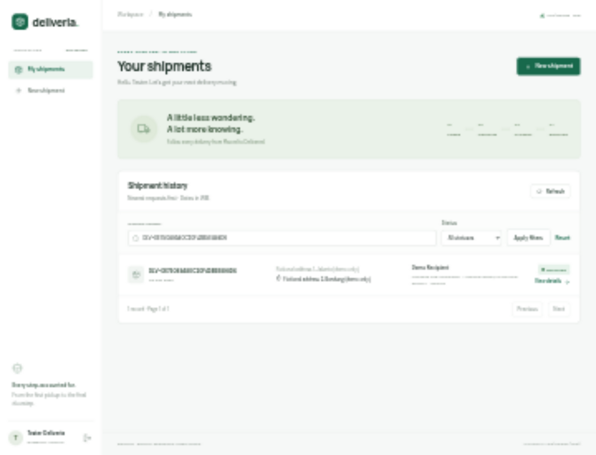
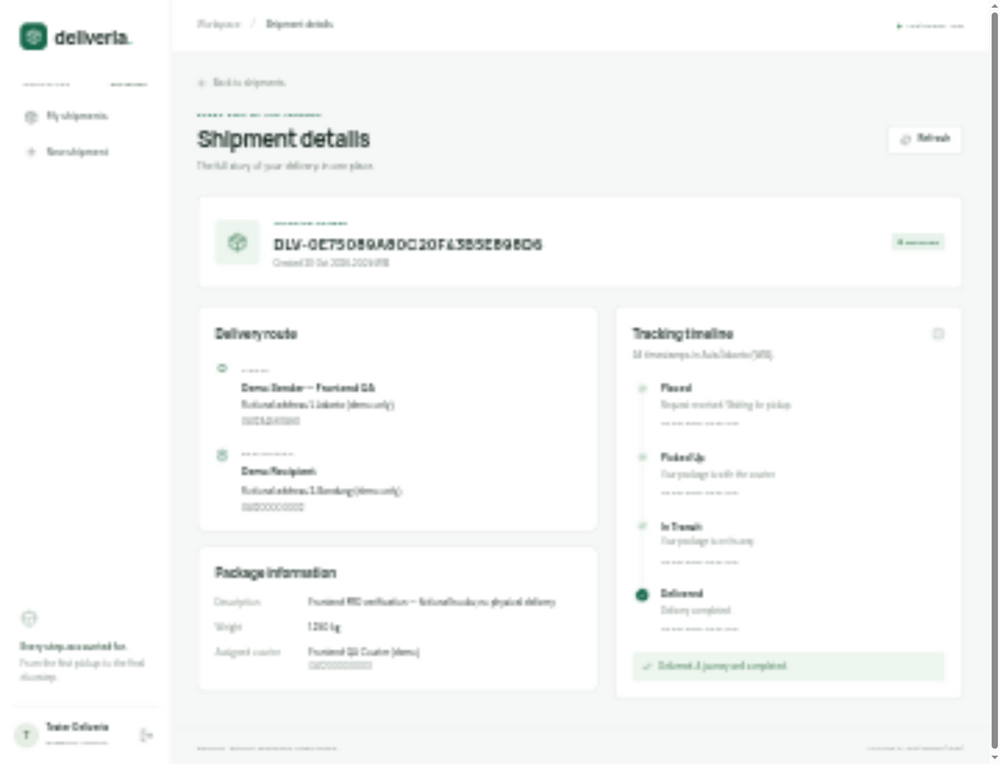
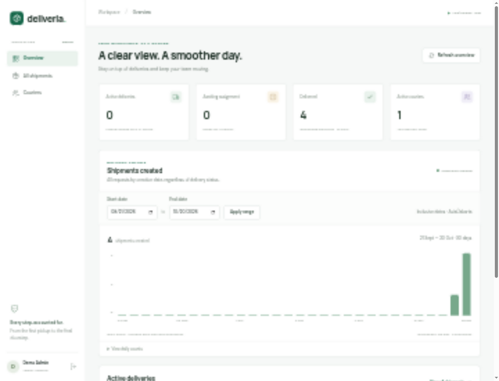
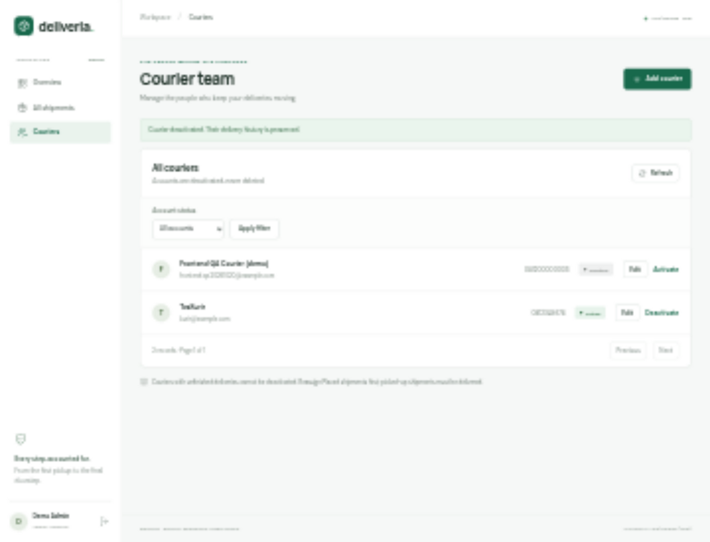

# Deliveria user guide

## Sign in and register

The app opens on the public landing page. Choose **Sign in** to access your account, or **Get started** to register. The Deliveria logo on the sign-in and registration pages returns to the landing page. New customers choose **Create an account** and provide name, email, phone, and password. Registration creates a Customer account only. Admins create Courier accounts; the backend's setup process provisions Admin accounts.

Sessions are memory-only. Reloading the browser requires another sign-in. Use the in-page **Refresh** buttons to get current server data. Sign out from the account section in the sidebar; on mobile, open the navigation menu first.

## Customer: request and track

1. Choose **New shipment**.
2. Enter sender and recipient contacts, pickup and delivery addresses, a package description, and a positive weight in kilograms (up to three decimal places).
3. Choose **Create shipment**. If validation or the network fails, the entered details remain available for correction/retry.
4. On success, keep the generated tracking number and choose **Track this shipment**.
5. Use **My shipments** to view history, filter by status or full tracking number, and move between pages.

The detail page shows addresses, phone numbers, package information, the assigned courier, and the complete chronological timeline. All timestamps are displayed in WIB (Asia/Jakarta). **Refresh** retrieves current information.

## Courier: advance a delivery

1. Open **My deliveries**. The default filter shows active work; choose Delivered to find completed deliveries.
2. Open a shipment's details to see contacts, addresses, and package information.
3. Perform the next milestone, then choose **Mark as Picked Up**, **Mark as In Transit**, or **Mark as Delivered**.
4. Confirm the action. The UI updates immediately with the server's new status and timestamped history.
5. If the server reports a conflict, refresh before trying again. Completed deliveries have no further status action.

Only assigned active couriers can update a shipment. The backend rejects skipped, repeated, and backward transitions.

## Admin: assign and monitor

Use **All shipments** to filter active work by status, full tracking number, courier, or Unassigned. Open a Placed shipment, choose an active courier, and confirm assignment. Reassignment is available only before pickup. Assignment does not advance the shipment's status. The detail page also shows assignment audit history.

The **Overview** shows operational totals and **Shipments created** by creation date. Choose inclusive start/end dates, then **Apply range** (maximum 366 days). This metric counts requests regardless of their current delivery stage. Zero-volume dates are included; **View daily counts** provides the same information in a table.

## Admin: manage couriers

Choose **Couriers**, then **Add courier** to create an active account. Share the initial password securely. **Edit** changes the name and phone; email/password are not editable in this release.

Activate or deactivate accounts using the corresponding action and confirmation dialog. Accounts with unfinished deliveries cannot be deactivated: first reassign any Placed shipments, and complete deliveries that have already been picked up. Deactivation preserves delivery history.

